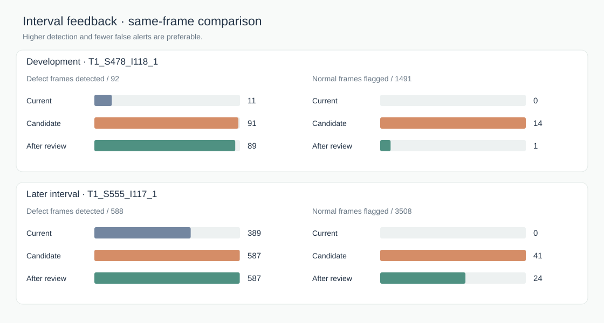

# Reviewed interval feedback

This experiment extends the [run-scoped reference](CONDITION_REFERENCE.md) with
a calibrated threshold and a review loop. It replays operator decisions using
public TSFabrics labels **only for frames selected without labels**. A new
candidate is measured on later frames; the source detector stays active.

## Pipeline

1. Freeze DINOv2-S/14 and the source patch bank. MMD on image features signals
   a sustained visual change.
2. From the next 512 frames, select 24 time-spaced reviews: 12 representative
   appearances and 12 high source scores. Fit a separate PCA residual scorer
   using only confirmed normal frames. Defect and uncertain reviews are excluded.
3. In the following, disjoint 128-frame window, request 64 systematic reviews
   without using their scores. Set the candidate threshold just above the
   **highest confirmed-normal score**. These frames do not fit the PCA model.
4. After a 64-frame gap, close an interval and offer 24 time-spaced reviews:
   four near the source threshold, four near the candidate threshold, eight
   where the decisions differ, and eight random audit frames. If a category
   lacks enough frames, use other disagreement cases and then random audit
   frames to complete the 24-case budget. This
   includes borderline cases on both sides of each threshold and checks for
   misses outside the alert queue.
5. Add only **confirmed normal frames flagged by the candidate** to the local
   PCA reference. Refit the candidate and rescore the original 64 calibration
   normals. The new threshold is the larger of the previous threshold and the
   recalibrated normal-score maximum. A reviewed defect missed after the update
   blocks the candidate. Otherwise, it remains a shadow candidate: no automatic
   promotion is implemented.
6. Evaluate the frozen source, candidate before review, and candidate after
   review on the **same later interval**, at least 64 frames after the summary.
   Ground-truth labels for that interval are read only for retrospective metrics.

The conservative threshold is a practical guard against a threshold drop after
refitting. It is **not** a mathematical guarantee that false alarms cannot rise:
the score scale changes with the PCA basis. The comparison below checks the
actual effect. A production release would require a separate acceptance test
with independently reviewed defects and a sufficiently large, temporally
diverse normal calibration set.

## Chronological evaluation

The fixed source is `T1_S174_I111_1`: frames 0–511 build the unlabeled source
reference; frames 512–2047 calibrate its threshold and change detector. For
both target runs, the first confirmed change alert is zero-based frame 192.
The review pool is `[192, 704)`, normal-only calibration `[704, 832)`, and
the first summary starts at frame 896. All ranges here are zero-based,
half-open. The review interface would display one-based frame numbers.

| Target run | Summary | Later test | Reviewed summary cases | Normal false alerts used for refit |
| --- | --- | --- | ---: | ---: |
| `T1_S478_I118_1` (development) | `[896, 1600)` | `[1664, 3247)` | 24: 16 normal, 8 defect | 6 |
| `T1_S555_I117_1` (later interval) | `[896, 4096)` | `[12288, 16384)` | 24: 12 normal, 12 defect | 2 |

The initial reference had 20 and 23 confirmed normals, respectively. Both
later test intervals are disjoint from reference, calibration, and summary.
The method was adjusted using the development run and earlier portions of
`T1_S555_I117_1`; its final 4,096-frame interval remained chronologically
later. This is a **later interval within a seen run**, not an independent,
untouched production-run validation.

### Same-frame results

`TP` counts defect **frames**, `FP` counts normal **frames** flagged. One defect
episode joins positive frames separated by at most eight frames. An episode is
detected if at least one of its positive frames is flagged. Ambiguous CSV/mask
disagreements are excluded.

| Test interval | Method | TP / defect frames | FP / normal frames | Detected defect episodes | AP |
| --- | --- | ---: | ---: | ---: | ---: |
| Development | Frozen active | 11 / 92 | 0 / 1,491 | 3 / 5 | .904 |
| Development | Candidate before interval review | 91 / 92 | 14 / 1,491 | 5 / 5 | .981 |
| Development | Candidate after interval review | 89 / 92 | 1 / 1,491 | 5 / 5 | .987 |
| Later interval | Frozen active | 389 / 588 | 0 / 3,508 | 21 / 21 | .989 |
| Later interval | Candidate before interval review | 587 / 588 | 41 / 3,508 | 21 / 21 | .999 |
| Later interval | Candidate after interval review | 587 / 588 | 24 / 3,508 | 21 / 21 | 1.000 |

On the development run, interval feedback reduced candidate FP from 14 to 1
but also reduced TP from 91 to 89; episode detection stayed 5/5. On the later
interval, FP fell from 41 to 24 at the same TP and episode count. The frozen
detector had no false alarms on either test, so the candidate's gain is
**frame-level sensitivity at a higher review burden**. It did not find an
additional defect episode on the later interval. The reviewed defects in the
summary remained detected after both updates (8/8 and 12/12). AP measures
ranking across thresholds, while TP and FP reflect the specified thresholds.

The 24 summary reviews are a deliberately mixed queue, not a random prevalence
sample. Their normal/defect proportions cannot estimate production defect
prevalence. The random audit subset provides limited coverage for misses but
does not establish a miss rate.



### Calibration and ablations

The 64 normal reviews are costly and still cannot certify a field false-alarm
rate. On an earlier 4,096-frame interval of `T1_S555_I117_1`, normal-review
budgets of 32, 64, and 128 gave candidate `(TP, FP)` of `(333, 79)`,
`(333, 56)`, and `(330, 23)` against 334 defect frames. On the next 4,096
frames, they gave `(356, 59)`, `(356, 48)`, and `(352, 22)` against 357
defect frames. More confirmed normals made the threshold less permissive at
some cost in recall. A frozen source scorer calibrated on the **same** 64
normal reviews had `(318, 165)` and `(349, 176)` on those two intervals. Thus
the gain there was not explained by threshold recalibration alone.

A T2 normal-only control did not improve: `T2_S262_I52_1` had 0 frozen
false alarms versus 5 with the 64-review PCA candidate. Another T2 interval
had no defects in its evaluation section, so it cannot support a recall claim.
The older unlabeled 99.5th-percentile target calibration could contain defects
and conceal them by raising the threshold; it is retained only as an ablation.

## What can be shown in an interval summary

The operational summary can show the interval's frame count, score and alert
traces, visual-change alerts, ranked image examples, which detector flagged
each example, and the 24 cases awaiting a `normal / defect / uncertain`
decision. Once decisions are entered, it can report counts **among reviewed
cases**, whether enough confirmed normals exist, the proposed threshold,
and a before/after shadow comparison on already reviewed cases. It cannot
know the interval's true defect recall, false-alarm count, or TP/FP without
exhaustive labels. The tables above use public labels solely for the offline
evaluation. The site should identify any precomputed replay as such rather
than presenting aggregate evaluation metrics as live operational knowledge.

## Reproduce

Run from the repository root with the locally downloaded dataset ZIP and DINOv2
feature cache. Uncached target features are encoded in RAM rather than stored
as a multi-gigabyte file. The 3090 server used
`/home/hyunsu/miniconda3/envs/autodex_bodex/bin/python`.

```bash
python experiments/unsupervised/review_calibration.py \
  --zip experiments/unsupervised/data/TSfabrics.zip \
  --cache experiments/unsupervised/features \
  --targets T1_S555_I117_1 --max-frames 12288 --later-start 8192 \
  --out experiments/unsupervised/results/review_calibration_future.json

python experiments/unsupervised/interval_feedback.py \
  --zip experiments/unsupervised/data/TSfabrics.zip \
  --cache experiments/unsupervised/features \
  --target T1_S478_I118_1 --limit 3247 --summary-end 1600 \
  --test-start 1664 --test-end 3247 \
  --out experiments/unsupervised/results/interval_feedback_mixed_dev2.json

python experiments/unsupervised/interval_feedback.py \
  --zip experiments/unsupervised/data/TSfabrics.zip \
  --cache experiments/unsupervised/features \
  --target T1_S555_I117_1 --limit 16384 --summary-end 4096 \
  --test-start 12288 --test-end 16384 \
  --out experiments/unsupervised/results/interval_feedback_future.json

node experiments/unsupervised/plot_feedback_loop.mjs
```

The raw images, weights, and feature cache remain outside Git. The result JSONs
contain aggregate metrics and the labels revealed on selected review cases.
